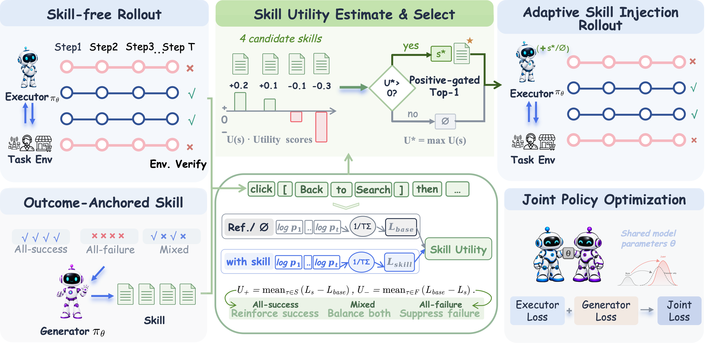
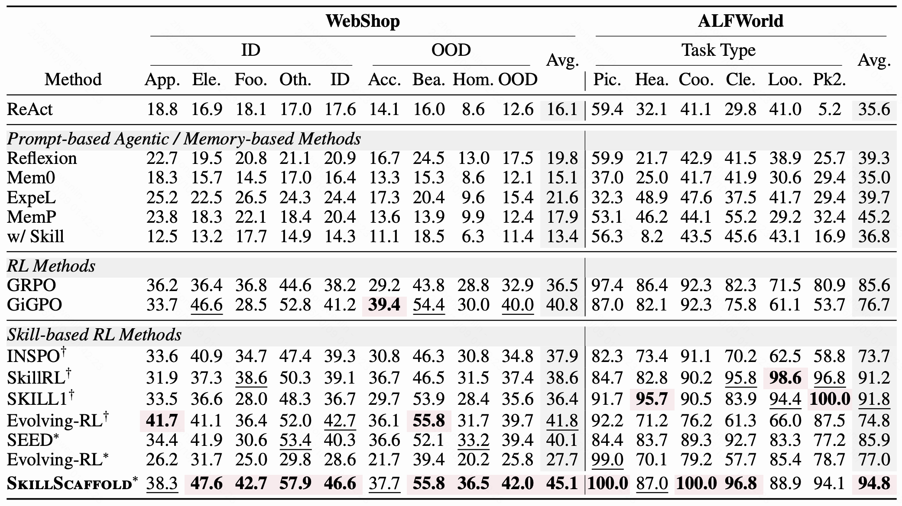
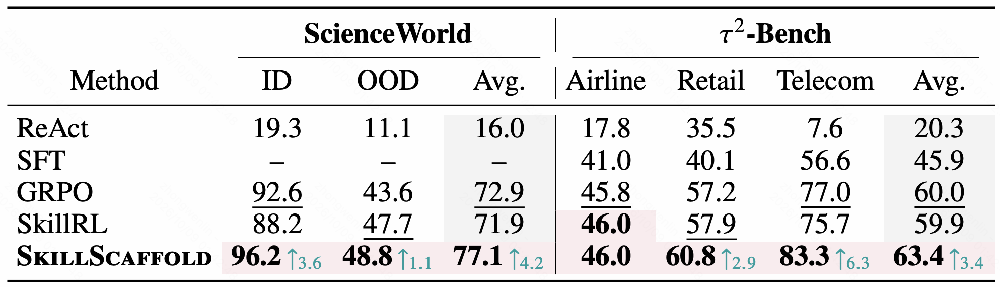

<div align="center">

# SkillScaffold

### Scaffolding Agentic Reinforcement Learning with Policy-Adaptive Skill Credit Assignment and Selective Injection

[](#%EF%B8%8F-setup)
[](https://huggingface.co/datasets/wwwenlin/skillscaffold-tau-rl)
[](LICENSE)

</div>

## 🔥 Overview

**SkillScaffold** provides training-time scaffolding for agentic reinforcement learning. It assesses the utility of textual skills for the current policy, injects skills only when their estimated utility is positive, and internalizes useful behaviors into model parameters, eliminating the need for an external skill library at inference time.

The method consists of four stages:

1. **Skill-free sampling.** The current Executor generates trajectories, and the environment verifies their task outcomes.
2. **Outcome-grounded skill generation.** Candidate skills are generated from all-success, all-failure, and mixed-outcome trajectory groups.
3. **Low-cost utility estimation and selection.** Outcome-aware likelihood comparisons on existing trajectories estimate each candidate's utility for the current policy, without additional environment rollouts for each candidate. The highest-scoring skill is injected only if its estimated utility is positive; otherwise, injection is skipped.
4. **Joint policy optimization.** The Generator and Executor are trained jointly, progressively internalizing the behaviors associated with useful skills into model parameters.


<p align="center">
  
</p>

## 📊 Results

<p align="center">
  
</p>

<p align="center">
  
</p>

## 🛠️ Setup


### 1. Create the Training Environment


```bash
# Choose one; each command performs the complete setup for that benchmark.
bash scripts/setup_env.sh alfworld
bash scripts/setup_env.sh webshop
bash scripts/setup_env.sh scienceworld
bash scripts/setup_env.sh tau

# Alternatively, install ALFWorld, WebShop, and ScienceWorld together.
bash scripts/setup_env.sh all
```


### 2. Download the Data

#### τ²-Bench


```bash
conda run -n skillscaffold-tau python scripts/download_tau_data.py \
  --repo wwwenlin/skillscaffold-tau-rl \
  --revision 6a159820a98351861d89a9d42f551f440e43ccd3
```

#### ALFWorld

```bash
conda run -n skillscaffold-alfworld alfworld-download \
  --data-dir data/alfworld/task_files -f
conda run -n skillscaffold-main python \
  benchmarks/alfworld/scripts/prepare_full3553.py \
  --data-root data/alfworld/task_files/json_2.1.1 \
  --output-dir benchmarks/alfworld/data
```


#### WebShop

```bash
conda run -n skillscaffold-webshop \
  bash benchmarks/webshop/scripts/download_data.sh
conda run -n skillscaffold-webshop \
  bash benchmarks/webshop/scripts/prepare_data.sh
```


#### ScienceWorld

```bash
conda run -n skillscaffold-main python \
  benchmarks/scienceworld/scripts/prepare_data.py \
  --output-dir data/scienceworld
```


## 🚀 Training

Before training, set your model checkpoint paths and required service endpoints in the generated `.env` file.

Choose one benchmark to start training. The scripts load `.env` automatically:

```bash
conda run -n skillscaffold-main --no-capture-output bash benchmarks/alfworld/scripts/train.sh
conda run -n skillscaffold-main --no-capture-output bash benchmarks/webshop/scripts/train.sh
conda run -n skillscaffold-main --no-capture-output bash benchmarks/scienceworld/scripts/train.sh
conda run -n skillscaffold-tau --no-capture-output bash benchmarks/tau/scripts/train.sh
```

τ²-Bench also supports a quick smoke test:

```bash
RUN_KIND=smoke conda run -n skillscaffold-tau --no-capture-output \
  bash benchmarks/tau/scripts/train.sh
```

## 🧪 Evaluation

Set the checkpoint to evaluate in `.env`, then choose one benchmark to start evaluation:


```bash
conda run -n skillscaffold-main --no-capture-output bash benchmarks/alfworld/scripts/eval.sh
conda run -n skillscaffold-main --no-capture-output bash benchmarks/webshop/scripts/eval.sh
conda run -n skillscaffold-main --no-capture-output bash benchmarks/scienceworld/scripts/eval.sh
conda run -n skillscaffold-tau-eval --no-capture-output bash benchmarks/tau/scripts/eval.sh
```


## ⭐ Citation

The paper is currently under anonymous review. Author information and the final BibTeX entry will be added after the anonymous review period.

## 🔗 Related Projects

We thank the authors and maintainers of the following projects:

- [Slime](https://github.com/THUDM/slime)
- [ALFWorld](https://github.com/alfworld/alfworld)
- [WebShop](https://github.com/princeton-nlp/WebShop)
- [τ²-Bench](https://github.com/sierra-research/tau2-bench)
- [AReaL τ² data](https://huggingface.co/datasets/inclusionAI/AReaL-tau2-data)
- [ScienceWorld](https://github.com/allenai/ScienceWorld)

## 📄 License

[Apache License 2.0](LICENSE)